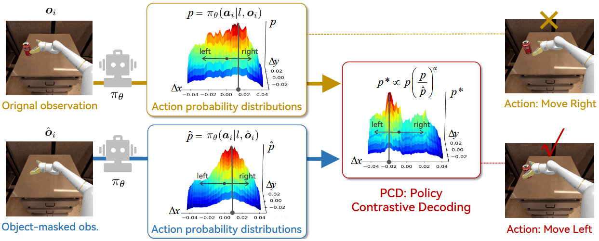
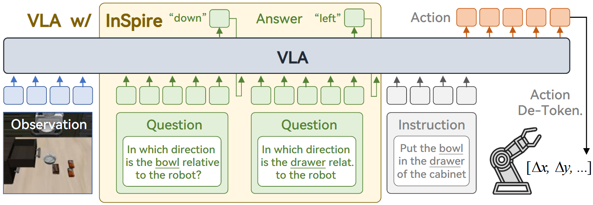
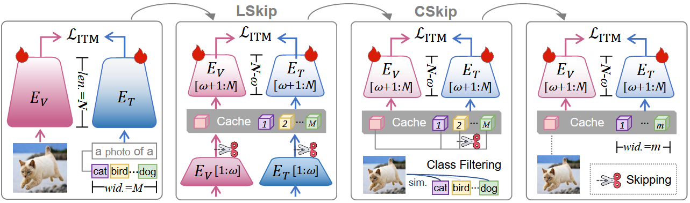

  

  <a href="./README.md">English</a> · <a href="./README_zh-CN.md">中文</a>

**Embodied Intelligence Researcher** at **Beijing Academy of Artificial Intelligence (BAAI)**. I received my M.Eng. in Computer Science and Technology from the **University of Electronic Science and Technology of China (UESTC)**.

My research focuses on large-scale manipulation data and embodied foundation models: intent-aware egocentric and bimanual datasets, vision-language-action adaptation, and vision-language model transfer. I have authored **7 papers**, including **CVPR**, **ICLR**, **ICRA**, and **IJCV**, with **300+ citations**; my released datasets are used by **360+ institutions** and have surpassed **100,000,000 cumulative downloads**.

  <a href="https://koorye.github.io/home/">Homepage</a> ·
  <a href="mailto:shihan.wu.koorye@outlook.com">Email</a> ·
  <a href="https://scholar.google.com/citations?hl=en&user=7VCaV5EAAAAJ">Google Scholar</a> ·
  <a href="https://dblp.org/pid/132/9517-1">DBLP</a> ·
  <a href="https://www.linkedin.com/in/shihan-wu-koorye/">LinkedIn</a> ·
  <a href="https://koorye.github.io/blog">Blog</a> ·
  <a href="https://koorye.github.io/home/resume-en.pdf">CV (EN)</a> ·
  <a href="https://koorye.github.io/home/resume-zh_CN.pdf">CV (中文)</a>

[Research Profile](#research-profile) · [News](#news) · [Experience](#experience) · [Education](#education) · [Publications](#publications) · [Awards](#awards) · [Technical Skills](#technical-skills) · [Gallery](#gallery)

---

## Research Profile

- **Large-scale manipulation data** — first-person and bimanual datasets, intent-aware acquisition, hierarchical annotation.
- **Embodied foundation models** — vision-language-action adaptation, test-time inference, and spatial reasoning.
- **Vision-language model transfer** — prompt tuning, parameter-efficient learning, and contrastive objectives.

Current work centers on **HumanCOIN** (12,500 hours of egocentric manipulation data, 38 scene classes, 30 institutions, with gaze/sEMG/EEG intent tiers) and **RoboCOIN** (20 institutions, 15 embodiments, 180K+ demonstrations).

## News

<b>Media Coverage</b> · Click to view more

- &nbsp;**ModelScope Community** — [BAAI RoboCOIN is officially open-sourced!](https://modelscope.csdn.net/69362ae92087ae0db79fd73a.html)
- &nbsp;**ModelScope Community** — [EAI-100: Top 100 Achievements & Figures in Embodied AI 2025 White Paper](https://www.modelscope.cn/learn/6060#4ever-bi-513)
- &nbsp;**Aiorang Open Class** — [RoboCOIN: Large-scale Dual-Arm Robot Dataset for Unified Manipulation](https://www.aiorang.com/c/ODA2ODM0MDM3YjA0NjNmMDIxNjM=)
- &nbsp;**AgileX Robotics** — [BAAI builds the first large-scale multi-embodiment dual-arm manipulation data infrastructure](https://mp.weixin.qq.com/s/_McJ6izPNzD--vHhyXLgGA)
- &nbsp;**Embodied AI Heart** — [PCD: Training-free & Plug-and-Play VLA](https://mp.weixin.qq.com/s/DdCxn9PgkTqmbkseWyheYQ)
- &nbsp;**DeepBlue Embodied AI** — [Breaking VLA spurious correlations](https://mp.weixin.qq.com/s/HJhvxMjd2uh8oZcaEVL_fA)
- &nbsp;**Multimodal Space** — [CoT-enhanced spatial reasoning for VLAs](https://mp.weixin.qq.com/s/JyAuCxVBEUjm8au2e75Wng)
- &nbsp;**LLMPhD** — [Skip Tuning: Lightweight adaptation for vision-language models](https://mp.weixin.qq.com/s?search_click_id=2008252490460296034-1774496722577-4783524904&__biz=MzYyMTIwMjM3MQ==&mid=2247483750&idx=1&sn=8a26c12c2c52bc289a98ef847e285fdd&chksm=fe1fc6aa7c2f9d00a1b35a36dea8599e94186d9aa013dad00a39211c9d5220e3ac99c6fc89ed&scene=7#rd)
- &nbsp;**Robot Lecture Hall** — [BAAI RoboCOIN: Largest real-world dual-arm dataset with fine-grained annotations](https://mp.weixin.qq.com/s?search_click_id=15991064877490272766-1774494403679-3589861850&__biz=MzI5MzE0NDUzNQ==&mid=2247483750&idx=1&sn=3477904ab8d66b47fd4ce9b869d3a69e&chksm=f5c0a43cb86a845ef3791ae7d7de7dda717ac1c011dc8e720123f30c199b71fce22d2b910309&scene=7#rd)

- **Nov. 2026** — HumanCOIN dataset released.
- **Nov. 2026** — Released datasets surpass 100,000,000 cumulative downloads.
- **Sep. 2026** — Papers surpass 300 citations.
- **Jun. 2026** — Joined BAAI as an Embodied Intelligence Researcher.
- **Jun. 2026** — Received Master's degree from UESTC.
- **May. 2026** — CCF YEF 2026 Best Academic Presentation Award (Master's Group).
- **Mar. 2026** — RoboCOIN selected as an EAI-100 Top-10 Dataset in 2025.

## Experience

&nbsp;**Embodied Intelligence Researcher** · Beijing Academy of Artificial Intelligence (BAAI) · *Jun 2026 – Present* 
Lead HumanCOIN and research on efficient VLA learning, with a focus on intent-aware manipulation data.

&nbsp;**Research Intern** · Beijing Academy of Artificial Intelligence (BAAI) · *Jun 2025 – Jun 2026* 
Led RoboCOIN (20 institutions, 15 embodiments, 180K+ demonstrations); research on Embodied Intelligence and VLA models.

## Education

&nbsp;**M.Eng. in Computer Science and Technology** · University of Electronic Science and Technology of China (UESTC) · *Sep 2023 – Jun 2026* 
Rank 6/454 · National Scholarship (2024) · Sichuan Outstanding Graduate (2026)

&nbsp;**B.Eng. in Software Engineering** · University of Electronic Science and Technology of China (UESTC) · *Sep 2019 – Jun 2023* 
Rank 18/181 · Outstanding Graduate (2023) · "Shiqiang" Special Scholarship (2022)

## Publications

🤖 **HumanCOIN: A 12,500-Hour Dataset for Human Intent in Egocentric Manipulation** 
*2026* 
12,500 hours of egocentric manipulation data across 38 scene classes, built with 30 institutions; includes gaze, sEMG, and EEG intent tiers. 
[Project](https://flagopen.github.io/HumanCOIN/) · [arXiv](https://arxiv.org/abs/2611.26434) · [PDF](https://arxiv.org/pdf/2611.26434) · [Code](https://github.com/FlagOpen/HumanCOIN/)

<b>Read more</b>

**TL;DR** — A 12,500-hour egocentric manipulation dataset across 38 scene classes and 30 institutions, with synchronized gaze, sEMG, and EEG signals for intent-aware embodied learning.

🤖 **RoboCOIN: An Open-Sourced Bimanual Robotic Data Collection for Integrated Manipulation** 
*2025* 
Open-source bimanual dataset with 15 embodiments and 180K+ demonstrations, built with 20 institutions; used by 360+ institutions, with 100M+ cumulative downloads across released datasets. 
[Project](https://flagopen.github.io/RoboCOIN/) · [arXiv](https://arxiv.org/abs/2511.17441) · [PDF](https://arxiv.org/pdf/2511.17441) · [Code](https://github.com/FlagOpen/RoboCOIN/)

<b>Read more</b>

**TL;DR** — An open-source bimanual manipulation dataset with 15 embodiments and 180K+ demonstrations, with hierarchical skill annotations and 360+ institutional users.

🤖 **[ICLR 2026]** **Policy Contrastive Decoding for Robotic Foundation Models** 
Training-free policy contrastive decoding across VLA models; +8%–41% gains on multiple backbones. 
[Project](https://koorye.github.io/PCD) · [arXiv](https://arxiv.org/abs/2505.13255) · [PDF](https://arxiv.org/pdf/2505.13255) · [Code](https://github.com/Koorye/PCD/)

<b>Read more</b>

**TL;DR** — A training-free decoding method that contrasts policy distributions across VLA architectures, improving performance by 8–41% without additional training.

🤖 **[ICRA 2026]** **InSpire: Vision-Language-Action Models with Intrinsic Spatial Reasoning** 
Intrinsic spatial reasoning reduces spurious VLA correlations; +6.2% on seen and +10% on unseen tasks. 
[Project](https://koorye.github.io/Inspire) · [arXiv](https://arxiv.org/abs/2505.13888) · [PDF](https://arxiv.org/pdf/2505.13888) · [Code](https://github.com/Koorye/Inspire/)

<b>Read more</b>

**TL;DR** — An intrinsic spatial reasoning approach for VLA models that reduces spurious correlations and improves seen (+6.2%) and unseen (+10%) task performance.

🖼️ **[CVPR 2025]** **Skip Tuning: Pre-trained Vision-Language Models are Effective and Efficient Adapters Themselves** 
Parameter-free VLM adaptation: +1.04% accuracy, 15× faster, and 6.4× lower memory footprint. 
[Project](https://koorye.github.io/SkipTuning/) · [arXiv](https://arxiv.org/abs/2412.11509) · [PDF](https://arxiv.org/pdf/2412.11509) · [Code](https://github.com/Koorye/SkipTuning)

<b>Read more</b>

**TL;DR** — A parameter-free adaptation method that turns pre-trained VLMs into effective and efficient adapters, improving accuracy while reducing inference time and memory.

🖼️ **[IJCV 2026]** **A Closer Look at Conditional Prompt Tuning for Vision-Language Models** 
Conditional prompt tuning for VLMs; +3.49% over the prior state of the art. 
[arXiv](https://arxiv.org/abs/2506.23856) · [PDF](https://arxiv.org/pdf/2506.23856) · [Code](https://github.com/Koorye/CaPT/)

<b>Read more</b>

**TL;DR** — A conditional prompt tuning method for VLMs that fixes key limitations of prior conditional PT and improves the state of the art by 3.49%.

🖼️ **[CVPR 2024]** **DePT: Decoupled Prompt Tuning** 
Plug-and-play decoupled prompt tuning; +0.67%–2.65% over prompt-tuning baselines. 
[Project](https://koorye.github.io/DePT/) · [arXiv](https://arxiv.org/abs/2309.07439) · [PDF](https://arxiv.org/pdf/2309.07439) · [Code](https://github.com/Koorye/DePT/)

<b>Read more</b>

**TL;DR** — A plug-and-play decoupled prompt tuning method that consistently improves diverse prompt-tuning baselines by 0.67–2.65%.

## Awards

- **CCF YEF 2026 Best Academic Presentation Award** (Master's Group) · China Computer Federation · 2026
- **Outstanding Graduate of Sichuan Province** · Education Department of Sichuan Province · 2026
- **Northern Automatic Control Special Scholarship** · Northern Automatic Control Technology Research Institute · 2026
- **Outstanding Graduate Student** · University of Electronic Science and Technology of China · 2025
- **National Scholarship** · Ministry of Education of the People's Republic of China · 2024
- **Outstanding Graduate** · University of Electronic Science and Technology of China · 2023
- **"Shiqiang" Special Scholarship** · Shenzhen Shiqiang Advanced Technology Co., Ltd. · 2022
- **National Meritorious Winner** · Mathematical Contest in Modeling (MCM) · 2021
- **National Bronze Award** · China "Internet+" College Student Innovation Competition · 2021

## Technical Skills

- **Research** — VLAs (OpenVLA, π0, Octo), VLMs (CLIP, LLaVA), prompt tuning, LoRA
- **Programming** — Python, Java, C/C++, C#, SQL
- **Frameworks** — PyTorch, Scikit-Learn, MMDetection, TensorFlow/Keras, JAX
- **Engineering** — Vue.js, Spring Boot, MySQL/Redis, Docker, Unity 3D

## Gallery

<table align="center">
  <tr>
    <td width="16.66%" align="center">
      
       BAAI
    </td>
    <td width="16.66%" align="center">
      
       UESTC
    </td>
    <td width="16.66%" align="center">
      
       Xiaomi Exchange Forum
    </td>
    <td width="16.66%" align="center">
      
       Agibot Visit
    </td>
    <td width="16.66%" align="center">
      
       Galbot Visit
    </td>
    <td width="16.66%" align="center">
      
       Shanghai AI Lab
    </td>
  </tr>
</table>

---

© 2026 Shihan Wu · <a href="https://koorye.github.io/home/">Homepage</a>

