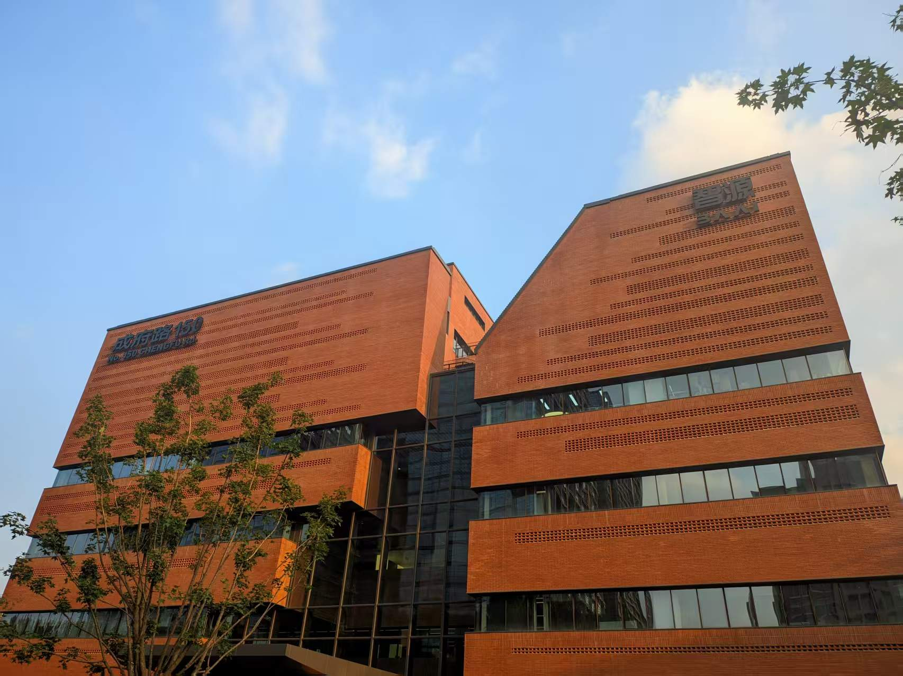
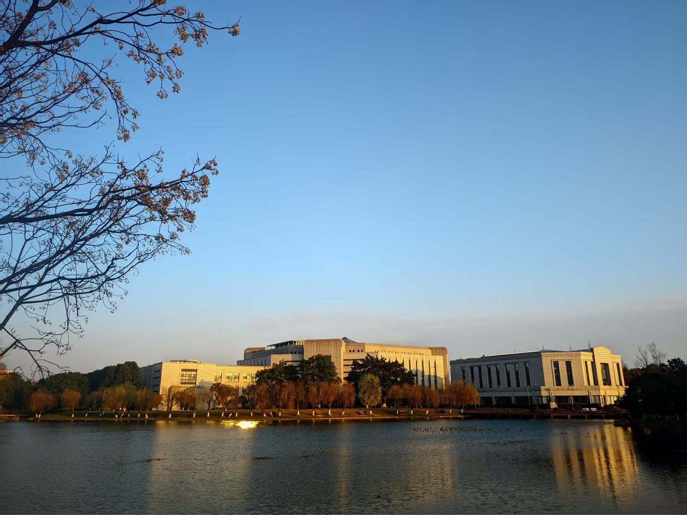
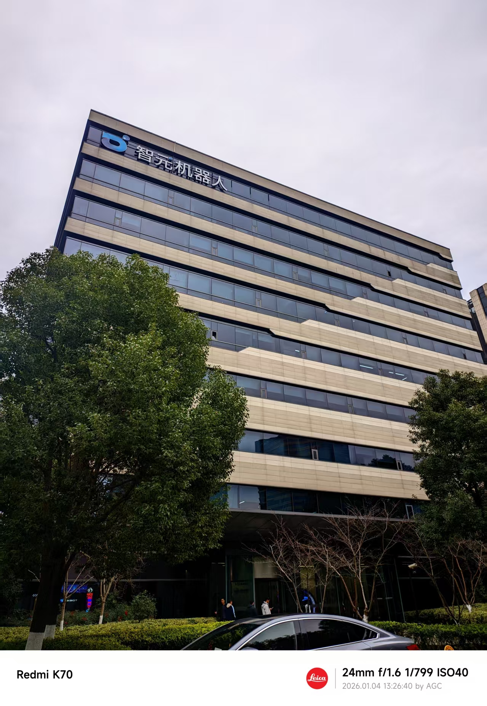
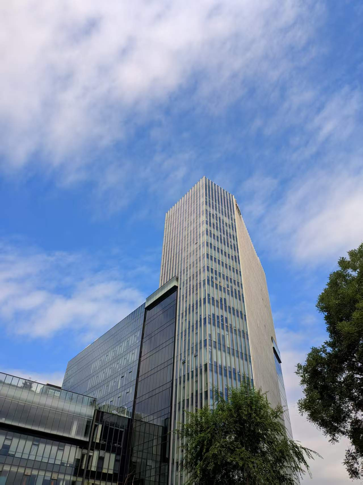
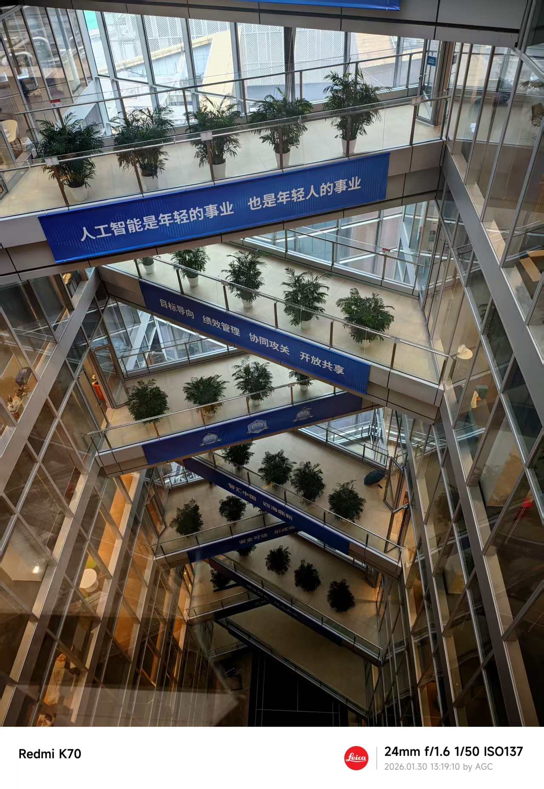

  
  ↑ This is Zhongguancun Science & Technology Park in Beijing, where I interned in summer 2025 ↑

[English](./README.md) | [中文](./README_zh-CN.md)

## 👨‍🔬 About Me

Hello! I am an <b>Embodied Intelligence Researcher</b> at <b>Beijing Academy of Artificial Intelligence (BAAI)</b>, and I received my Master's degree from the <b>School of Computer Science and Engineering</b> of <b>University of Electronic Science and Technology of China (UESTC)</b>.

<b>Research Interests:</b> Embodied Intelligence, Vision-Language-Action Models, and Large-Scale Robotic Datasets.

I have published <b>7 papers</b>, including <b>CVPR</b>, <b>ICLR</b>, <b>ICRA</b>, and <b>IJCV</b>. My papers have received over <b>300 citations</b>, and my open-source datasets have been used by <b>360+ institutions</b> worldwide with over <b>100,000,000 downloads</b>. I have been invited to serve as a reviewer for <b>NeurIPS</b>, <b>ICLR</b>, and <b>TPAMI</b>. Feel free to reach out to me via email for any inquiries or collaborations!

  
  
  
  
  
  
  

---

### 📢 News

- **[Nov. 2026]** 🎉 Our **HumanCOIN** dataset is now released!
- **[Nov. 2026]** 📈 Our open-source datasets have surpassed **100,000,000** cumulative downloads!
- **[Sep. 2026]** 📈 My papers have received over **300 citations**!
- **[Jun. 2026]** 🔭 I officially joined **Beijing Academy of Artificial Intelligence (BAAI)** as an **Embodied Intelligence Researcher**!
- **[Jun. 2026]** 🎓️ I received my **Master's degree** from **UESTC**!
- **[May. 2026]** 🏆 I was invited to the **CCF Young Elite Forum 2026 (YEF 2026)** and won the **Best Presentation Award** in the Master's Group!
- **[Mar. 2026]** 🎉 Our **RoboCOIN** dataset has been rated as a **EAI-100 Top-10 Dataset in 2025** by ModelScope and CCF TCIR!

<b>🔍 Media Reports & Coverage</b>

- 🌏 **[ModelScope Community]** [BAAI RoboCOIN is officially open-sourced!](https://modelscope.csdn.net/69362ae92087ae0db79fd73a.html)
- 🌏 **[ModelScope Community]** [EAI-100: Top 100 Achievements & Figures in Embodied AI 2025 White Paper](https://www.modelscope.cn/learn/6060#4ever-bi-513)
- 🎙️ **[Aiorang Open Class]** [RoboCOIN: Large-scale Dual-Arm Robot Dataset for Unified Manipulation | Public Lecture](https://www.aiorang.com/c/ODA2ODM0MDM3YjA0NjNmMDIxNjM=)
- 🏢 **[AgileX Robotics]** [BAAI builds the first large-scale multi-embodiment dual-arm manipulation data infrastructure](https://mp.weixin.qq.com/s/_McJ6izPNzD--vHhyXLgGA)
- 📰 **[Embodied AI Heart]** [PCD: Training-free & Plug-and-Play VLA that avoids spurious correlations in action prediction](https://mp.weixin.qq.com/s/DdCxn9PgkTqmbkseWyheYQ)
- 📰 **[DeepBlue Embodied AI]** [Breaking VLA spurious correlations! Simple spatial reasoning boosts generalization by 4x](https://mp.weixin.qq.com/s/HJhvxMjd2uh8oZcaEVL_fA)
- 📰 **[Multimodal Space]** [Connecting high-dimensional spaces via reasoning: CoT-enhanced spatial reasoning for VLAs](https://mp.weixin.qq.com/s/JyAuCxVBEUjm8au2e75Wng)
- 📰 **[LLMPhD]** [Skip Tuning by UESTC & Tongji: Lightweight adaptation for vision-language models](https://mp.weixin.qq.com/s?search_click_id=2008252490460296034-1774496722577-4783524904&__biz=MzYyMTIwMjM3MQ==&mid=2247483750&idx=1&sn=8a26c12c2c52bc289a98ef847e285fdd&chksm=fe1fc6aa7c2f9d00a1b35a36dea8599e94186d9aa013dad00a39211c9d5220e3ac99c6fc89ed&scene=7#rd)
- 📰 **[Robot Lecture Hall]** [BAAI RoboCOIN: Largest real-world dual-arm dataset with fine-grained annotations](https://mp.weixin.qq.com/s?search_click_id=15991064877490272766-1774494403679-3589861850&__biz=MzI5MzE0NDUzNQ==&mid=2247483750&idx=1&sn=3477904ab8d66b47fd4ce9b869d3a69e&chksm=f5c0a43cb86a845ef3791ae7d7de7dda717ac1c011dc8e720123f30c199b71fce22d2b910309&scene=7#rd)

---

### 💼 Experience

- 🏢 **Embodied Intelligence Researcher** · Beijing Academy of Artificial Intelligence (BAAI) · *2026.06 - Present*
  - Leading **HumanCOIN** (12,500 h egocentric manipulation data, 38 scene classes, 30 institutions) and efficient VLA learning research
- 🏢 **Research Intern** · Beijing Academy of Artificial Intelligence (BAAI) · *2025.06 - 2026.06*
  - Led **RoboCOIN** (20 institutions, 15 embodiments, 180K+ demonstrations); research on Embodied Intelligence and VLA models
- 🎓 **Master's Student in Computer Science and Technology** · UESTC · *2023.09 - 2026.06*
  - 📊 Rank: **6/454 (Top 1.3%)** · 🔬 Focus: Embodied Intelligence, VLA, Large-Scale Robotic Datasets
  - 🏆National Scholarship (2024), 🏅Sichuan Province Outstanding Graduate (2026)
- 🎓 **Bachelor of Software Engineering** · UESTC, Software Engineering · *2019.09 - 2023.06*
  - 📊 Rank: **18/181 (Top 10%)**
  - 🏅UESTC Outstanding Graduate (2023), 🏆"Shiqiang" Special Scholarship (2022)

---

### 📕 Publications

* 🤖 **[arXiv 2026]** **HumanCOIN: A 12,500-Hour Dataset for Human Intent in Egocentric Manipulation**  
  [[Project]](https://flagopen.github.io/HumanCOIN/) [[arXiv]](https://arxiv.org/abs/2611.26434) [[PDF]](https://arxiv.org/pdf/2611.26434) [[Code]](https://github.com/FlagOpen/HumanCOIN/) 
    * Large-scale egocentric manipulation dataset with **12,500 hours** of data across **38 scene classes**, built with **30 institutions**; includes gaze, sEMG, and EEG intent tiers.

* 🤖 **[EAI-100 TOP-10 Datasets in 2025]** **RoboCOIN: An Open-Sourced Bimanual Robotic Data Collection for Integrated Manipulation**  
  [[Project]](https://flagopen.github.io/RoboCOIN/) [[arXiv]](https://arxiv.org/abs/2511.17441) [[PDF]](https://arxiv.org/pdf/2511.17441) [[Code]](https://github.com/FlagOpen/RoboCOIN/) 
    * Open-sourced large-scale bimanual robotic dataset with **15 robotic platforms** and **180K+ demonstrations**, built with **20 institutions**; used by **360+ institutions**; our released datasets have over **100,000,000** cumulative downloads, serving as training data for models such as **Alibaba Qwen-RobotManip**, **DAMO RynnValue**, **Alibaba Cloud PAIWorld**, and **PKU LDA-1B**.

* 🤖 **[ICLR 2026]** **Policy Contrastive Decoding for Robotic Foundation Models**  
  [[Project]](https://koorye.github.io/PCD) [[arXiv]](https://arxiv.org/abs/2505.13255) [[PDF]](https://arxiv.org/pdf/2505.13255) [[Code]](https://github.com/Koorye/PCD/) 
    * Universal framework for multiple VLA architectures, achieving **+8%~41% improvement** without training.

* 🤖 **[ICRA 2026]** **InSpire: Vision-Language-Action Models with Intrinsic Spatial Reasoning**  
  [[Project]](https://koorye.github.io/Inspire) [[arXiv]](https://arxiv.org/abs/2505.13888) [[PDF]](https://arxiv.org/pdf/2505.13888) [[Code]](https://github.com/Koorye/Inspire/) 
    * Reducing spurious correlations in VLAs, boosting performance on **seen (+6.2%)** and **unseen (+10%)** tasks.

* 🖼️ **[CVPR 2025]** **Skip Tuning: Pre-trained Vision-Language Models are Effective and Efficient Adapters Themselves**  
  [[Project]](https://koorye.github.io/SkipTuning/) [[arXiv]](https://arxiv.org/abs/2412.11509) [[PDF]](https://arxiv.org/pdf/2412.11509) [[Code]](https://github.com/Koorye/SkipTuning) 
    * Parameter-free adaptation method, **+1.04%** accuracy with **15x** speedup and **6.4x** memory efficiency.

* 🖼️ **[IJCV 2026]** **A Closer Look at Conditional Prompt Tuning for Vision-Language Models**  
  [[arXiv]](https://arxiv.org/abs/2506.23856) [[PDF]](https://arxiv.org/pdf/2506.23856) [[Code]](https://github.com/Koorye/CaPT/) 
    * Identified critical issues in existing conditional prompt tuning methods, outperforming the state-of-the-art conditional PT methods by **3.49%**.

* 🖼️ **[CVPR 2024]** **DePT: Decoupled Prompt Tuning**  
  [[Project]](https://koorye.github.io/DePT/) [[arXiv]](https://arxiv.org/abs/2309.07439) [[PDF]](https://arxiv.org/pdf/2309.07439) [[Code]](https://github.com/Koorye/DePT/) 
    * Plug-and-play method providing **+0.67%~2.65% gains** across various prompt tuning baselines.

---

### 🏆 Awards

- 🎓 **CCF YEF 2026 Best Academic Presentation Award (Master's Group)** · China Computer Federation · *2026*
- 🎓 **Outstanding Graduate of Sichuan Province** · Education Department of Sichuan Province · *2026*
- 💰 **Northern Automatic Control Special Scholarship** · North Automatic Control Technology Research Institute · *2026*
- 🎓 **Outstanding Graduate Student** · University of Electronic Science and Technology of China · *2025*
- 💰 **National Scholarship** · Ministry of Education of the People's Republic of China · *2024*
- 🎓 **Outstanding Graduate** · University of Electronic Science and Technology of China · *2023*
- 💰 **"Shiqiang" Special Scholarship** · Shenzhen Shiqiang Advanced Technology Co., Ltd. · *2022*
- 🏆 **National Meritorious Winner** · Mathematical Contest in Modeling (MCM) · *2021*
- 🏆 **National Bronze Award** · China "Internet+" College Student Innovation Competition · *2021*

---

### 🛠️ Technical Arsenal

| Category | Skills & Frameworks |
| :--- | :--- |
| **Programming Languages** |      |
| **AI Frameworks** |      |
| **Develop & DevOps** |       |

---

### 📊 GitHub Activity

<table align="center" border="0">
  <tr>
    <td width="50%" align="center">
      
    </td>
    <td width="50%" align="center">
      
    </td>
  </tr>
</table>

  

---

### 🖼️ Gallery

<table align="center" border="0">
  <tr>
    <td width="50%" align="center">
      
      
<b>Beijing Academy of Artificial Intelligence</b>

    </td>
    <td width="50%" align="center">
      
      
<b>University of Electronic Science and Technology of China</b>

    </td>
  </tr>
</table>
<table>
  <tr>
    <td width="25%" align="center">
      
      
Xiaomi Top Fresh Graduate Exchange Forum

    </td>
    <td width="25%" align="center">
      
      
Agibot Elite Program Visit

    </td>
    <td width="25%" align="center">
      
      
Visiting Galbot Company

    </td>
    <td width="25%" align="center">
      
      
Shanghai AI Laboratory Talent Exchange Forum

    </td>
  </tr>
</table>
