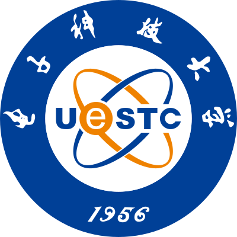
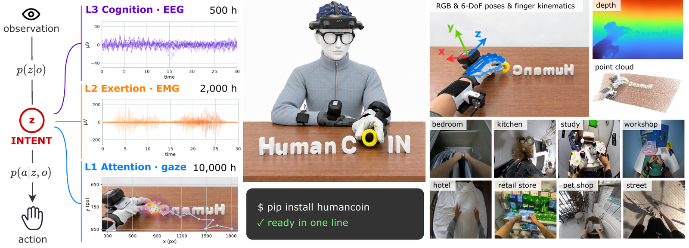
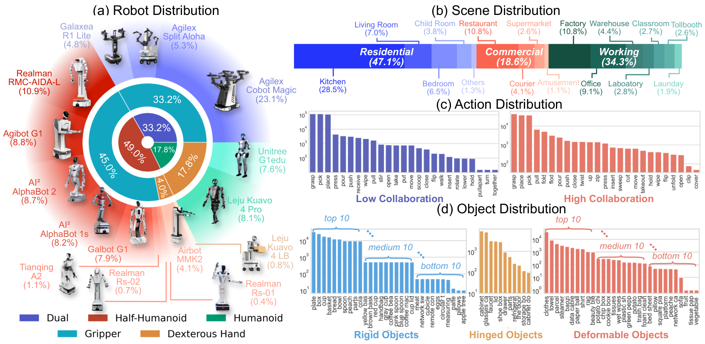
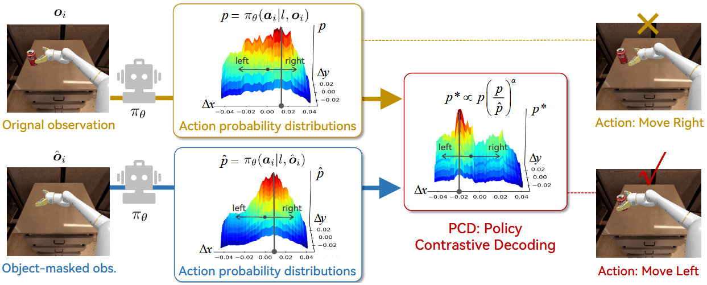
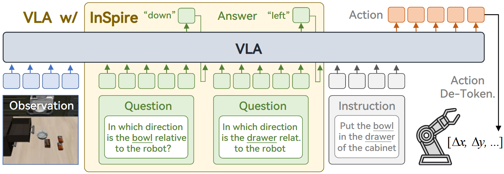
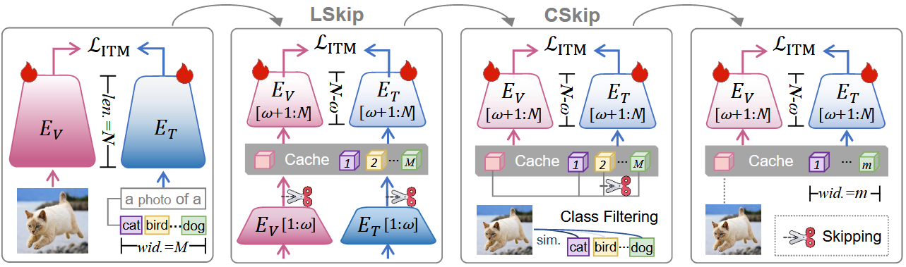
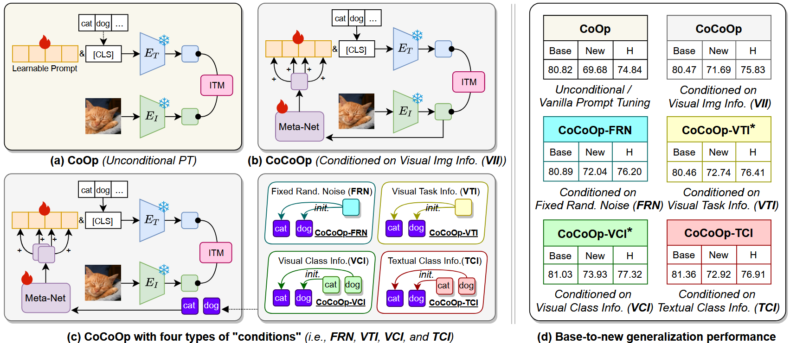
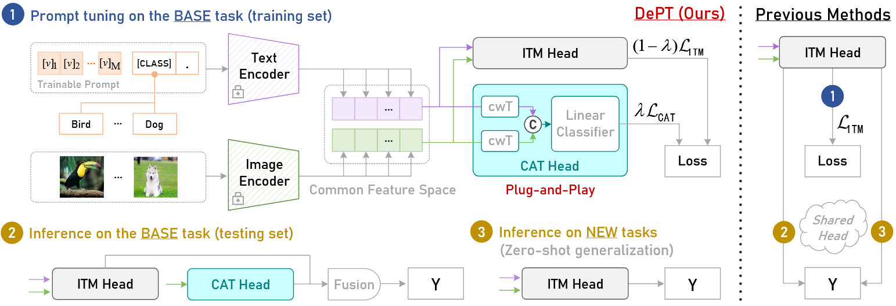
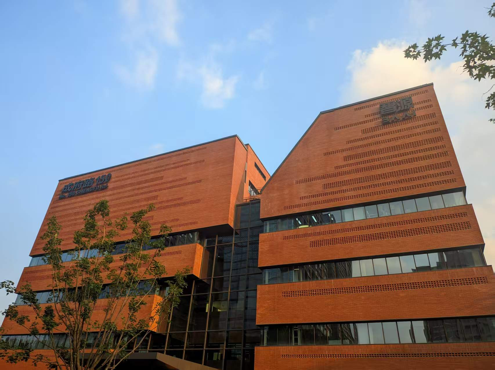

  

  <a href="./README.md">English</a> · <a href="./README_zh-CN.md">中文</a>

**具身智能研究员**，任职于**北京智源人工智能研究院（BAAI）**，硕士毕业于**电子科技大学计算机科学与技术**专业。

我的研究聚焦大规模机器人操作数据与具身基础模型：第一人称与双臂数据集的意图感知采集、视觉-语言-动作模型适配，以及视觉语言模型的高效迁移。已发表 **7 篇论文**，其中包括 **CVPR**、**ICLR**、**ICRA**、**IJCV**，引用 **300+**；开源数据集被 **360+ 家机构**使用，累计下载 **1 亿+**。

  <a href="https://koorye.github.io/home/">个人主页</a> ·
  <a href="mailto:shihan.wu.koorye@outlook.com">邮箱</a> ·
  <a href="https://scholar.google.com/citations?hl=en&user=7VCaV5EAAAAJ">谷歌学术</a> ·
  <a href="https://dblp.org/pid/132/9517-1">DBLP</a> ·
  <a href="https://www.linkedin.com/in/shihan-wu-koorye/">LinkedIn</a> ·
  <a href="https://koorye.github.io/blog">博客</a> ·
  <a href="https://koorye.github.io/home/resume-en.pdf">简历（英文）</a> ·
  <a href="https://koorye.github.io/home/resume-zh_CN.pdf">简历（中文）</a>

[研究简介](#研究简介) · [最新动态](#最新动态) · [工作经历](#工作经历) · [教育经历](#教育经历) · [发表论文](#发表论文) · [荣誉奖项](#荣誉奖项) · [技术能力](#技术能力) · [相册](#相册)

---

## 研究简介

- **大规模机器人操作数据** — 第一人称与双臂数据集、意图感知采集、层次化标注。
- **具身基础模型** — 视觉-语言-动作模型适配、测试时推理与空间推理。
- **视觉语言模型迁移** — 提示调优、参数高效学习与对比学习。

当前工作围绕 **HumanCOIN**（12,500 小时第一人称操作数据、38 个场景类别、30 家机构，包含注视/表面肌电/脑电三层意图信号）与 **RoboCOIN**（20 家机构、15 个本体、18 万+ 演示数据）。

## 最新动态

### 媒体报道与专题

- &nbsp;**魔搭社区** — [智源 RoboCOIN 数据集正式开源！](https://modelscope.csdn.net/69362ae92087ae0db79fd73a.html)
- &nbsp;**魔搭社区** — [EAI-100: 2025 具身智能白皮书百强成果与人物入选](https://www.modelscope.cn/learn/6060#4ever-bi-513)
- &nbsp;**将门创投** — [RoboCOIN: 用于统一操控的大规模双臂机器人数据集](https://www.aiorang.com/c/ODA2ODM0MDM3YjA0NjNmMDIxNjM=)
- &nbsp;**松灵机器人** — [智源研究院构建首个大规模多具身双臂操控数据基础设施](https://mp.weixin.qq.com/s/_McJ6izPNzD--vHhyXLgGA)
- &nbsp;**具身智能之心** — [PCD: 无需训练、即插即用的 VLA](https://mp.weixin.qq.com/s/DdCxn9PgkTqmbkseWyheYQ)
- &nbsp;**深蓝学院** — [打破 VLA 伪相关！简单的空间推理让泛化能力提升 4 倍](https://mp.weixin.qq.com/s/HJhvxMjd2uh8oZcaEVL_fA)
- &nbsp;**多模态空间** — [通过推理连接高维空间：思维链增强的 VLA 空间推理](https://mp.weixin.qq.com/s/JyAuCxVBEUjm8au2e75Wng)
- &nbsp;**LLMPhD** — [成电 & 同济 Skip Tuning: 视觉语言模型的轻量化适配方案](https://mp.weixin.qq.com/s?search_click_id=2008252490460296034-1774496722577-4783524904&__biz=MzYyMTIwMjM3MQ==&mid=2247483750&idx=1&sn=8a26c12c2c52bc289a98ef847e285fdd&chksm=fe1fc6aa7c2f9d00a1b35a36dea8599e94186d9aa013dad00a39211c9d5220e3ac99c6fc89ed&scene=7#rd)
- &nbsp;**机器人大讲堂** — [智源 RoboCOIN: 带有细粒度标注的最大规模真实世界双臂数据集](https://mp.weixin.qq.com/s?search_click_id=15991064877490272766-1774494403679-3589861850&__biz=MzI5MzE0NDUzNQ==&mid=2247483750&idx=1&sn=3477904ab8d66b47fd4ce9b869d3a69e&chksm=f5c0a43cb86a845ef3791ae7d7de7dda717ac1c011dc8e720123f30c199b71fce22d2b910309&scene=7#rd)

### 近期动态

- **2026.11** — HumanCOIN 数据集正式发布。
- **2026.11** — 开源数据集累计下载量突破 1 亿次。
- **2026.09** — 论文总引用量突破 300 次。
- **2026.06** — 加入北京智源人工智能研究院，担任具身智能研究员。
- **2026.06** — 于电子科技大学获得硕士学位。
- **2026.05** — 获 CCF YEF 2026 最佳学术展示奖（硕士组）。
- **2026.03** — RoboCOIN 入选 EAI-100 2025 年度十大数据集。

## 工作经历

&nbsp;**具身智能研究员** · 北京智源人工智能研究院（BAAI） · *2026.06 – 至今* 
主导 HumanCOIN，研究 VLA 的高效学习范式，重点关注意图感知的机器人操作数据。

&nbsp;**研究实习生** · 北京智源人工智能研究院（BAAI） · *2025.06 – 2026.06* 
主导 RoboCOIN（20 家机构、15 个本体、18 万+ 演示数据）；从事具身智能与 VLA 研究。

## 教育经历

&nbsp;**计算机科学与技术 · 学术硕士** · 电子科技大学（UESTC） · *2023.09 – 2026.06* 
排名 6/454 · 国家奖学金（2024） · 四川省优秀毕业生（2026）

&nbsp;**软件工程 · 工学学士** · 电子科技大学（UESTC） · *2019.09 – 2023.06* 
排名 18/181 · 优秀毕业生（2023） · “世强”专项奖学金（2022）

## 发表论文

🤖 **HumanCOIN: A 12,500-Hour Dataset for Human Intent in Egocentric Manipulation** 
*2026* 
12,500 小时第一人称操作数据，覆盖 38 个场景类别，由 30 家机构联合构建；包含注视、表面肌电与脑电三层意图信号。 
[项目主页](https://flagopen.github.io/HumanCOIN/) · [arXiv](https://arxiv.org/abs/2611.26434) · [PDF](https://arxiv.org/pdf/2611.26434) · [代码](https://github.com/FlagOpen/HumanCOIN/)

<b>展开查看</b>

**TL;DR** — 12,500 小时第一人称操作数据集，覆盖 38 个场景类别与 30 家机构，包含同步的注视、表面肌电与脑电信号，用于意图感知的具身学习。

🤖 **RoboCOIN: An Open-Sourced Bimanual Robotic Data Collection for Integrated Manipulation** 
*2025* 
开源双臂机器人数据集，涵盖 15 个本体与 18 万+ 演示数据，由 20 家机构联合构建；已被 360+ 家机构使用，发布的数据集累计下载量超过 1 亿次。 
[项目主页](https://flagopen.github.io/RoboCOIN/) · [arXiv](https://arxiv.org/abs/2511.17441) · [PDF](https://arxiv.org/pdf/2511.17441) · [代码](https://github.com/FlagOpen/RoboCOIN/)

<b>展开查看</b>

**TL;DR** — 开源双臂操作数据集，涵盖 15 个本体、18 万+ 演示与层次化技能标注，已被 360+ 家机构使用。

🤖 **[ICLR 2026]** **Policy Contrastive Decoding for Robotic Foundation Models** 
面向多种 VLA 架构的免训练策略对比解码，无需训练即可获得 +8%–41% 的性能提升。 
[项目主页](https://koorye.github.io/PCD) · [arXiv](https://arxiv.org/abs/2505.13255) · [PDF](https://arxiv.org/pdf/2505.13255) · [代码](https://github.com/Koorye/PCD/)

<b>展开查看</b>

**TL;DR** — 一种免训练的策略对比解码方法，在多种 VLA 架构上通过对比策略分布获得 8%–41% 的性能提升。

🤖 **[ICRA 2026]** **InSpire: Vision-Language-Action Models with Intrinsic Spatial Reasoning** 
引入内在空间推理减轻 VLA 的虚假相关性，在可见任务上提升 +6.2%、未见任务上提升 +10%。 
[项目主页](https://koorye.github.io/Inspire) · [arXiv](https://arxiv.org/abs/2505.13888) · [PDF](https://arxiv.org/pdf/2505.13888) · [代码](https://github.com/Koorye/Inspire/)

<b>展开查看</b>

**TL;DR** — 为 VLA 模型引入内在空间推理，减轻虚假相关性，在可见任务上提升 +6.2%、未见任务上提升 +10%。

🖼️ **[CVPR 2025]** **Skip Tuning: Pre-trained Vision-Language Models are Effective and Efficient Adapters Themselves** 
无需额外参数的 VLM 适配方法：+1.04% 精度、15× 加速、6.4× 内存效率。 
[项目主页](https://koorye.github.io/SkipTuning/) · [arXiv](https://arxiv.org/abs/2412.11509) · [PDF](https://arxiv.org/pdf/2412.11509) · [代码](https://github.com/Koorye/SkipTuning)

<b>展开查看</b>

**TL;DR** — 一种无参数适配方法，将预训练 VLM 转化为高效适配器，在提升精度的同时降低推理时间与内存。

🖼️ **[IJCV 2026]** **A Closer Look at Conditional Prompt Tuning for Vision-Language Models** 
面向 VLM 的文本条件提示调优，相较此前条件 PT 最优方法提升 +3.49%。 
[arXiv](https://arxiv.org/abs/2506.23856) · [PDF](https://arxiv.org/pdf/2506.23856) · [代码](https://github.com/Koorye/CaPT/)

<b>展开查看</b>

**TL;DR** — 面向 VLM 的条件提示调优方法，解决已有条件 PT 的关键问题，并将最优结果提升 +3.49%。

🖼️ **[CVPR 2024]** **DePT: Decoupled Prompt Tuning** 
即插即用的解耦提示调优方法，在多种提示调优基线上普遍提升 +0.67%–2.65%。 
[项目主页](https://koorye.github.io/DePT/) · [arXiv](https://arxiv.org/abs/2309.07439) · [PDF](https://arxiv.org/pdf/2309.07439) · [代码](https://github.com/Koorye/DePT/)

<b>展开查看</b>

**TL;DR** — 即插即用的解耦提示调优方法，在多种提示调优基线上稳定提升 0.67%–2.65%。

## 荣誉奖项

- **CCF YEF 2026 最佳学术展示奖（硕士组）** · 中国计算机学会 · 2026
- **四川省优秀毕业生** · 四川省教育厅 · 2026
- **北方自动控制专项奖学金** · 北方自动控制技术研究所 · 2026
- **电子科技大学优秀研究生** · 电子科技大学 · 2025
- **国家奖学金** · 中华人民共和国教育部 · 2024
- **电子科技大学优秀毕业生** · 电子科技大学 · 2023
- **“世强”专项奖学金** · 深圳市世强先进科技有限公司 · 2022
- **美国大学生数学建模竞赛 Meritorious Winner** · MCM · 2021
- **中国“互联网+”大学生创新创业大赛全国铜奖** · 2021

## 技术能力

- **研究方向** — VLA（OpenVLA、π0、Octo）、VLM（CLIP、LLaVA）、Prompt Tuning、LoRA
- **编程语言** — Python、Java、C/C++、C#、SQL
- **算法框架** — PyTorch、Scikit-Learn、MMDetection、TensorFlow/Keras、JAX
- **工程能力** — Vue.js、Spring Boot、MySQL/Redis、Docker、Unity 3D

## 相册

<table align="center">
  <tr>
    <td width="16.66%" align="center">
      
       北京智源人工智能研究院
    </td>
    <td width="16.66%" align="center">
      
       电子科技大学
    </td>
    <td width="16.66%" align="center">
      
       小米交流会
    </td>
    <td width="16.66%" align="center">
      
       智元参观
    </td>
    <td width="16.66%" align="center">
      
       银河通用参观
    </td>
    <td width="16.66%" align="center">
      
       上海 AI Lab
    </td>
  </tr>
</table>

---

© 2026 吴世涵 · <a href="https://koorye.github.io/home/">个人主页</a>

